# [전자회로설계및실험II] Audio Amplifier Project

### 프로젝트 설명

사람의 가청 주파수는 20Hz~200kHz이다. 
그러나 보통 5kHz이하의 주파수가 중요한 신호로 받아 들여지고 있다.

본 프로젝트는 음원이 5kHz내에 음악 신호가 있고 10kHz에 Noise 성분이 있을 때 Amplifier와 Low Pass Filter를 5kHz 이하 주파수 대역을 최대한 왜곡시키지 않으면서, 10kHz 주파수를 갖는 noise를 최소화하도록 구현하여 스피커를 구동하는 게 목표이다.

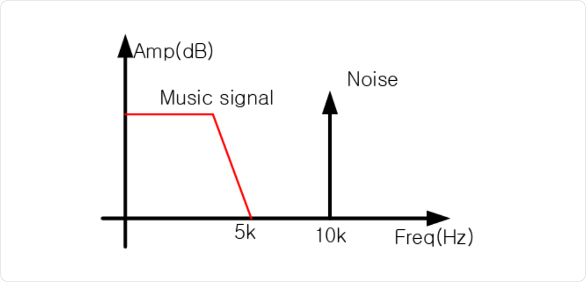

주어진 회로의 Topology내에서 소자들의 값을 지정하여 구현하여야 한다.

### 회로 Schematic

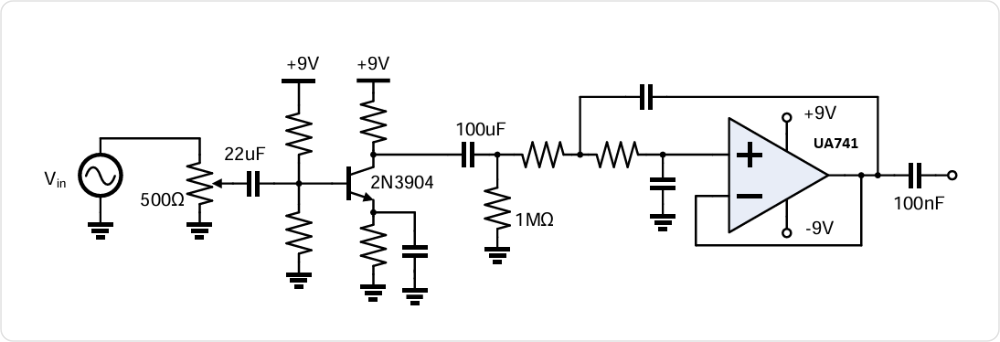

주어진 회로는 CE Stage Emitter Degeneration Amplifier와 Sallen-Key LPF의 조합으로 이루어져있다.

위에 나와있는 소자 종류 및 값들은 정해진 값이며, 정해지지 않은 소자의 값을 바꾸어 가며 구현한다.

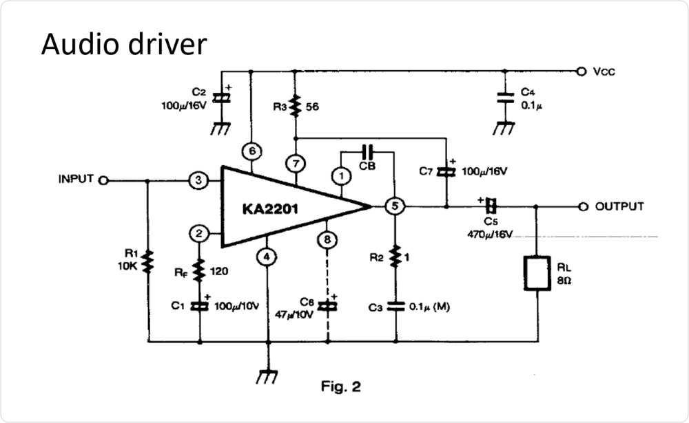

CE Stage Amplifier와 LPF를 거친 후 뒷 단의 Audio Driver를 통해 스피커를 구동하게 된다.
Audio Amplifier는 위와 같다.

#### Resistor Table

| **기본값** | **×1 Ω** | **×10 Ω** | **×100 Ω** | **×1 kΩ** | **×10 kΩ** | **×100 kΩ** | **×1 MΩ** |
| --- | --- | --- | --- | --- | --- | --- | --- |
| **1.0** | 1.0 Ω | 10 Ω | 100 Ω | 1.0 kΩ | 10 kΩ | 100 kΩ | 1.0 MΩ |
| **1.1** | 1.1 Ω | 11 Ω | 110 Ω | 1.1 kΩ | 11 kΩ | 110 kΩ | 1.1 MΩ |
| **1.2** | 1.2 Ω | 12 Ω | 120 Ω | 1.2 kΩ | 12 kΩ | 120 kΩ | 1.2 MΩ |
| **1.3** | 1.3 Ω | 13 Ω | 130 Ω | 1.3 kΩ | 13 kΩ | 130 kΩ | 1.3 MΩ |
| **1.5** | 1.5 Ω | 15 Ω | 150 Ω | 1.5 kΩ | 15 kΩ | 150 kΩ | 1.5 MΩ |
| **1.6** | 1.6 Ω | 16 Ω | 160 Ω | 1.6 kΩ | 16 kΩ | 160 kΩ | 1.6 MΩ |
| **1.8** | 1.8 Ω | 18 Ω | 180 Ω | 1.8 kΩ | 18 kΩ | 180 kΩ | 1.8 MΩ |
| **2.0** | 2.0 Ω | 20 Ω | 200 Ω | 2.0 kΩ | 20 kΩ | 200 kΩ | 2.0 MΩ |
| **2.2** | 2.2 Ω | 22 Ω | 220 Ω | 2.2 kΩ | 22 kΩ | 220 kΩ | 2.2 MΩ |
| **2.4** | 2.4 Ω | 24 Ω | 240 Ω | 2.4 kΩ | 24 kΩ | 240 kΩ | 2.4 MΩ |
| **2.7** | 2.7 Ω | 27 Ω | 270 Ω | 2.7 kΩ | 27 kΩ | 270 kΩ | 2.7 MΩ |
| **3.0** | 3.0 Ω | 30 Ω | 300 Ω | 3.0 kΩ | 30 kΩ | 300 kΩ | 3.0 MΩ |
| **3.3** | 3.3 Ω | 33 Ω | 330 Ω | 3.3 kΩ | 33 kΩ | 330 kΩ | 3.3 MΩ |
| **3.6** | 3.6 Ω | 36 Ω | 360 Ω | 3.6 kΩ | 36 kΩ | 360 kΩ | 3.6 MΩ |
| **3.9** | 3.9 Ω | 39 Ω | 390 Ω | 3.9 kΩ | 39 kΩ | 390 kΩ | 3.9 MΩ |
| **4.3** | 4.3 Ω | 43 Ω | 430 Ω | 4.3 kΩ | 43 kΩ | 430 kΩ | 4.3 MΩ |
| **4.7** | 4.7 Ω | 47 Ω | 470 Ω | 4.7 kΩ | 47 kΩ | 470 kΩ | 4.7 MΩ |
| **5.1** | 5.1 Ω | 51 Ω | 510 Ω | 5.1 kΩ | 51 kΩ | 510 kΩ | 5.1 MΩ |
| **5.6** | 5.6 Ω | 56 Ω | 560 Ω | 5.6 kΩ | 56 kΩ | 560 kΩ | 5.6 MΩ |
| **6.2** | 6.2 Ω | 62 Ω | 620 Ω | 6.2 kΩ | 62 kΩ | 620 kΩ | 6.2 MΩ |
| **6.8** | 6.8 Ω | 68 Ω | 680 Ω | 6.8 kΩ | 68 kΩ | 680 kΩ | 6.8 MΩ |
| **7.5** | 7.5 Ω | 75 Ω | 750 Ω | 7.5 kΩ | 75 kΩ | 750 kΩ | 7.5 MΩ |
| **8.2** | 8.2 Ω | 82 Ω | 820 Ω | 8.2 kΩ | 82 kΩ | 820 kΩ | 8.2 MΩ |
| **9.1** | 9.1 Ω | 91 Ω | 910 Ω | 9.1 kΩ | 91 kΩ | 910 kΩ | 9.1 MΩ |

#### Capacitor Table

세라믹/필름 소용량 대역 (pF ~ nF)

| **기본 계수** | **pF 대역** | **10 pF 대역** | **100 pF 대역** | **1.0 nF 대역** | **10 nF 대역** | **100 nF 대역** |
| --- | --- | --- | --- | --- | --- | --- |
| **1.0** | 1.0 pF | 10 pF | 100 pF | 1.0 nF | 10 nF | 100 nF (0.1 µF) |
| **1.2** | 1.2 pF | 12 pF | 120 pF | 1.2 nF | 12 nF | 120 nF |
| **1.5** | 1.5 pF | 15 pF | 150 pF | 1.5 nF | 15 nF | 150 nF |
| **1.8** | 1.8 pF | 18 pF | 180 pF | 1.8 nF | 18 nF | 180 nF |
| **2.2** | 2.2 pF | 22 pF | 220 pF | 2.2 nF | 22 nF | 220 nF |
| **2.7** | 2.7 pF | 27 pF | 270 pF | 2.7 nF | 27 nF | 270 nF |
| **3.3** | 3.3 pF | 33 pF | 330 pF | 3.3 nF | 33 nF | 330 nF |
| **3.9** | 3.9 pF | 39 pF | 390 pF | 3.9 nF | 39 nF | 390 nF |
| **4.7** | 4.7 pF | 47 pF | 470 pF | 4.7 nF | 47 nF | 470 nF |
| **5.6** | 5.6 pF | 56 pF | 560 pF | 5.6 nF | 56 nF | 560 nF |
| **6.8** | 6.8 pF | 68 pF | 680 pF | 6.8 nF | 68 nF | 680 nF |
| **8.2** | 8.2 pF | 82 pF | 820 pF | 8.2 nF | 82 nF | 820 nF |

중대용량 대역 (µF ~ mF)

| **구분** | **주요 표준 용량 목록** |
| --- | --- |
| **1 ~ 9.1 µF** | 1.0 µF, 1.5 µF, 2.2 µF, 3.3 µF, 4.7 µF, 6.8 µF, 8.2 µF |
| **10 ~ 91 µF** | 10 µF, 12 µF, 15 µF, 18 µF, 22 µF, 27 µF, 33 µF, 39 µF, 47 µF, 56 µF, 68 µF, 82 µF |
| **100 ~ 910 µF** | 100 µF, 120 µF, 150 µF, 180 µF, 220 µF, 270 µF, 330 µF, 390 µF, 470 µF, 560 µF, 680 µF, 820 µF |
| **1,000 µF 이상 (mF)** | 1000 µF (1 mF), 1500 µF, 2200 µF, 3300 µF, 4700 µF, 6800 µF, 10000 µF (10 mF) |

슈퍼 커패시터 / EDLC 대역 (F 단위)

| **구분** | **상용 표준 셀 용량** |
| --- | --- |
| **1 F ~ 9.9 F** | 1.0 F, 1.5 F, 2.0 F, 2.5 F, 2.7 F, 3.0 F, 3.3 F, 4.7 F, 5.0 F, 7.0 F |
| **10 F ~ 100 F 이상** | 10 F, 15 F, 20 F, 25 F, 30 F, 50 F, 60 F, 100 F, 120 F, 150 F, 350 F, 400 F |

### CE Stage Amplifier 설계

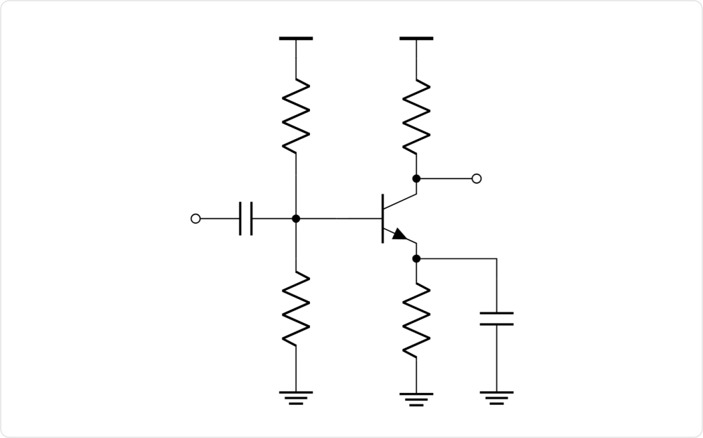

회로의 구성은 위와 같다.

먼저 Bias Voltage $V_{BE}$를 0.7V, $\beta$=100으로 가정하고 Bias단을 Thevnin Equivalent Circuit으로 변환하면:

$$
V_{TH}=\frac{R_1}{R_1+R_2}V_{CC} \\ \\ \;
\\
R_{TH}=R_1\parallel R_2
$$

이를 통해 $I_B$를 구해보면 아래와 같다.

$$
I_B=\frac{V_{TH}-V_{BE}}{R_{TH}+(1+\beta)R_E}
$$

$$
I_C=\beta\cdot I_B
$$

따라서 구해진 $I_C$로 $V_E, V_{C}$를 구해보면

$$
V_E=I_CR_E
$$

$$
V_{C}=V_{CC}-I_CR_C
$$

$V_C$가 가능한 낮을 수록 Voltage Swing 범위가 넓어진다. 그러나 $R_C$를 늘리게 되면 LPF에서 바라볼 때의 저항 $R_{out}$이 늘어나므로 $R_C$ 또한 작아져야 한다.

따라서 $I_C$를 약 2mA가 나오도록 $R_1, R_2, R_E$의 값을 정하였다.

$R_{TH}$보다 $(1+\beta)R_E$가 충분히 커야 $I_B=\frac{V_{TH}-V_{BE}}{R_{TH}+(1+\beta)R_E}$의 식에 의해 $I_C=\beta I_B\approx \frac{V_{TH}-V_{BE}}{R_E}$이 되어 Bias Current가 $\beta$ Variation에 강해지므로 $R_E$를 390, $R_{TH}$는 두 저항 값이 많이 차이날수록 작은 값을 따라가므로 $R_2=3.9\text k, R_1=18\text k$로 결정하였다.

위 값에 따라 $I_C$는 2.12mA의 값으로 결정되었다.

$g_m$또한 82.5mS로 결정되었다.

$R_C$는 $1.8\text k$로 Gain이 140[V/V]가 나오도록 설계하였다.

$C_E$는 우리가 사용하는 Audio 대역에서 완전히 Bypass되도록 5kHz에서 0.4ohm을 갖는 500uF로 결정하였다.

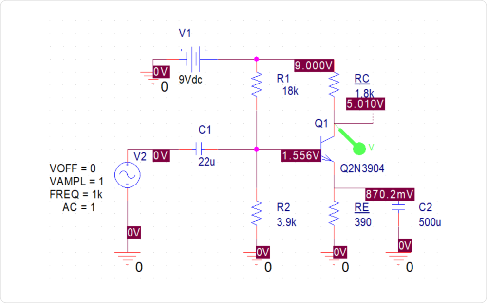

회로 구성은 위와 같다.

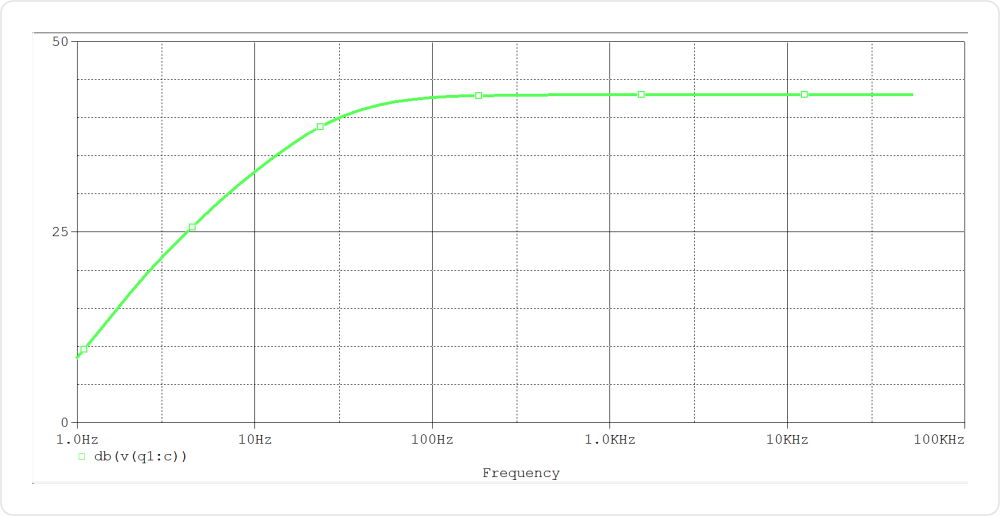

AC sweep을 하였을 때의 dB Scale 결과이다.
약 43dB, 143[V/V]의 결과가 도출되었다.

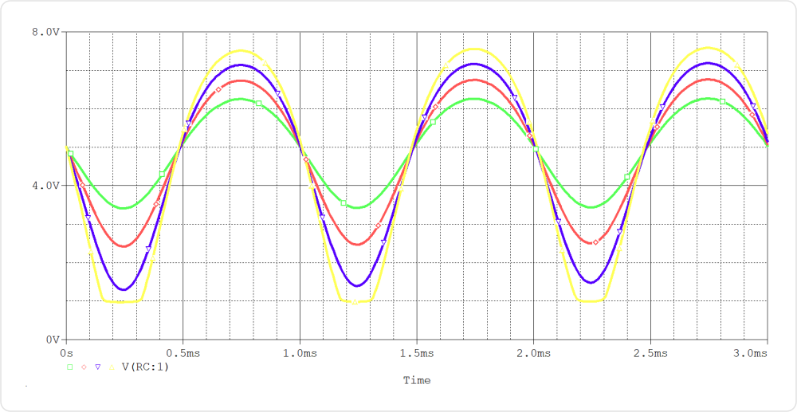

0.02Vpp부터 0.01 Step으로 transient 시뮬레이션을 돌렸을때의 결과이다. 약 0.05Vpp부터 Distortion이 발생하는 것을 확인할 수 있다.

### LPF 설계

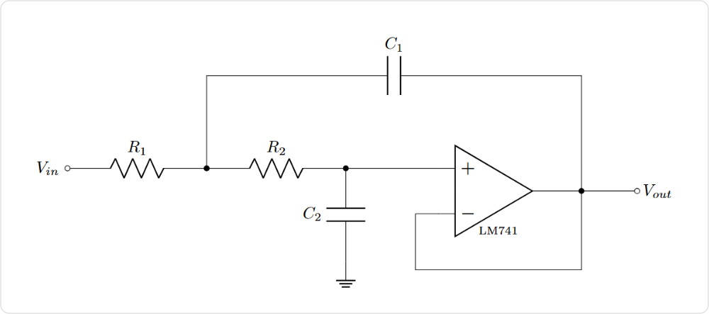

Sallen-Key LPF의 Transfer Function을 구해보면 다음과 같다 :

$$
% Unity-gain Sallen-Key low-pass filter (requires \usepackage{amsmath})
\begin{align}
H(s) &= \frac{V_{out}(s)}{V_{in}(s)}
      = \frac{1}{s^{2} R_1 R_2 C_1 C_2 + s\, C_2 (R_1 + R_2) + 1} \\
\end{align}
$$

2nd-Order system이므로 Transfer Function을 Q value($Q$)와 Natural Frequecy($\omega_0$)로 구할 수 있다.

$$
\begin{align}

H(s) &= {ω_0² \over {(s² + (ω_0/Q)·s + ω_0²)}}
\end{align}
$$

$$
\begin{align}

\omega_0 &= \sqrt{1\over R_1R_2C_1C_2},

\;\;\;\;\;Q=\sqrt\frac{R_1R_2C_1}{(R_1+R_2)^2C_2}

\end{align}
$$

여기서 계산의 편의를 위해 $R_1=R_2=R, C_1=aC_2 = aC$로 두면 아래와 같이 간단히 정리할 수 있다

$$
\begin{align}

\omega_0 &= {1\over RC}\cdot{\frac{1}{\sqrt{a}}},

\;\;\;\;\;Q=\frac{1}{2}\sqrt a

\end{align}
$$

2nd-Order System의 식 (
$H(s) = {ω_0² \over {(s² + (ω_0/Q)·s + ω_0²)}}$)에 $s=j\omega$를 대입하여 정리하면 다음과 같다.

$$
\begin{align}

H(\omega) = {ω_0² \over {(-ω² + j(ω_0/Q)·ω + ω_0²)}}

\end{align}
$$

$$
\begin{align}

&&&&&&&&= { 1 \over {(-ω²/ω_0^2 + j(1/Qω_0)·ω + 1)}}

\end{align}
$$

$$
\begin{align}

&&&&&&= { 1 \over {(1-(ω/ω_0)^2 + j(ω/Qω_0) )}}

\end{align}
$$

10kHz에서 감쇠를 보기 위해 Magnitude $|H(\omega)|^2$를 구해보면

$$
\begin{align}
|H(\omega)|^2= { 1 \over {(1-(ω/ω_0)^2)^2 + (ω/Qω_0)^2 }}

\end{align}
$$

$$
\begin{align}
&&&&&&&= { 1 \over {\left({ω\overω_0}\right)^4 +\left({1\over Q}-2\right) }\cdot\left({ω\overω_0}\right)^2+1}

\end{align}
$$

dB Scale로 바꾸면 

$$
G(\omega) = 10\log_{10}|H(\omega)|^2
$$

$$
G(\omega)=10\log_{10}\left[{\left({ω\overω_0}\right)^4 +\left({1\over Q}-2\right) }\cdot\left({ω\overω_0}\right)^2+1\right]
$$

위 식을 통해 Natural Frequency와 Q가 주어졌을 때 특정 Frequency에서 Signal의 Magnitude를 구할 수 있다.

우리가 원하는 신호는 20~5kHz이므로 이 구간에서는 Magnitude가 $\pm1\text{dB}$이상 변하지 않도록 제약 조건을 주고, 10kHz의 Frequency일 때 Magnitude를 최대한으로 변하게 하는 Q와 Natural Frequency를 MATLAB에서 Sweep하여 구하였다.

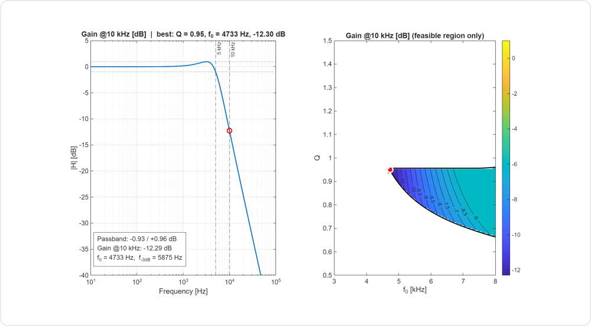

제약 조건 내에서 구한 최적점은 Q=0.95, $f_0$ = 4733Hz이므로 이를 통해 소자 값들을 역산할 수 있다.

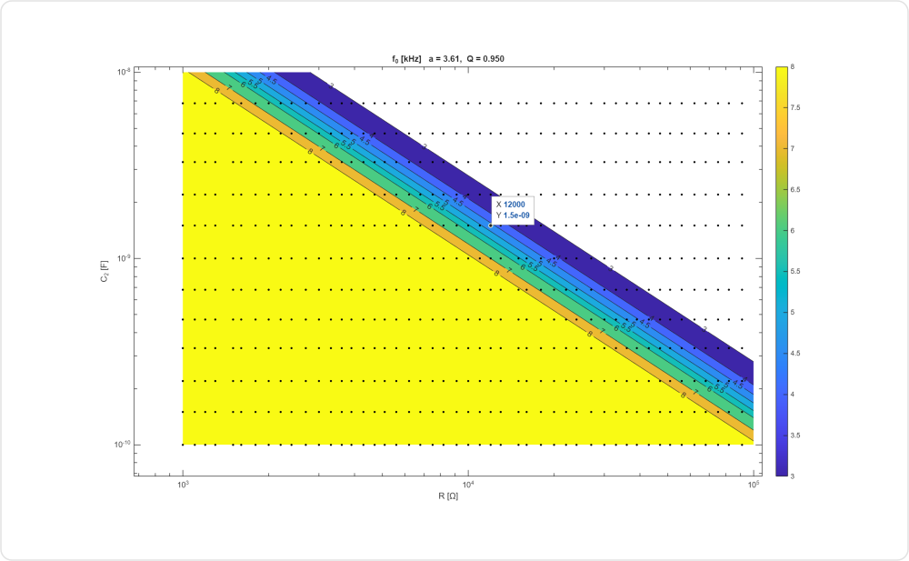

위 플롯에서 대각선은 $f_0$의 값을 나타내며 검은 점들이 사용가능한 소자 값에 해당하며 그 중 $f_0$가 4733Hz에 가까운 점들 중에 선택하여 $C_2$와 $R$ 값을 결정하였을 때 $R_1=R_2=12k\Omega$, $C_2=1.5\text {nF}$, 
$C_1=aC_2=1.5\text{e-9 } \cdot 3.61\approx5.6\text{nF}$로 결정하였다. 

위 플롯에 사용된 코드는 아래 링크에서 확인할 수 있다.

[https://drive.mathworks.com/sharing/45c895ba-bc64-43e9-9014-f39a889d67fb/Q_f0.mlx](https://drive.mathworks.com/sharing/45c895ba-bc64-43e9-9014-f39a889d67fb/Q_f0.mlx)

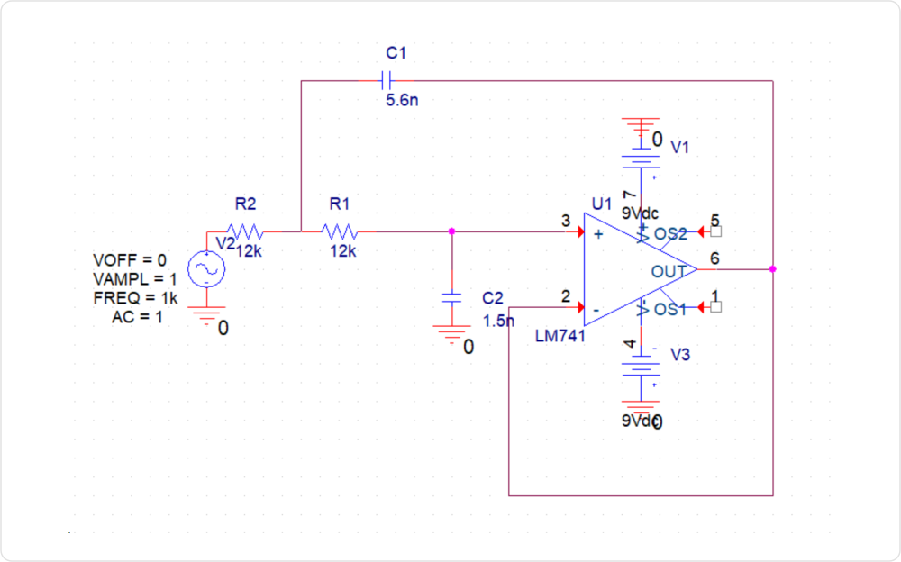

LPF의 회로 구성은 위와 같다.

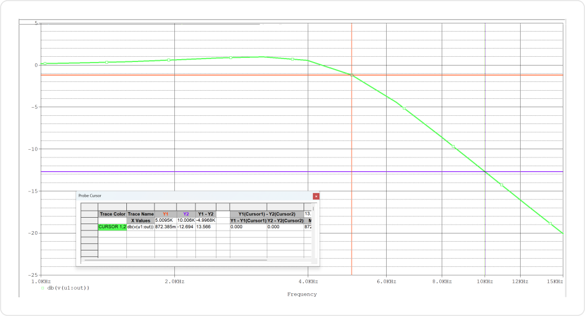

5kHz에서 약 0.8dB의 변화만 있으며, 10kHz에선 12dB의 감쇠가 일어났다.

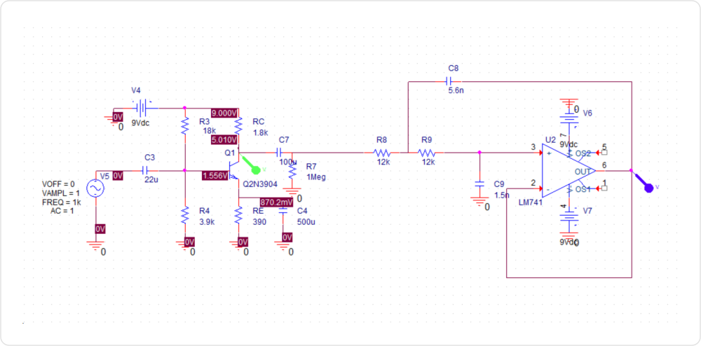

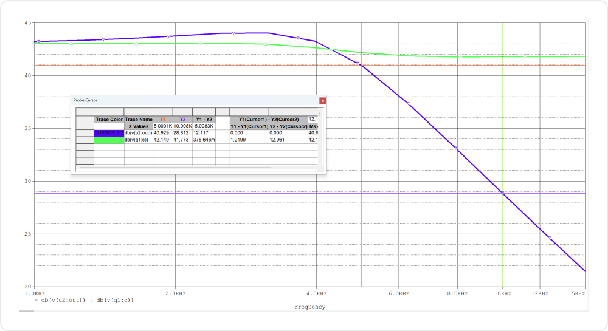

전체 회로 구성 및 AC Sweep 결과이다.

동일하게 10kHz 대역에서 약 12dB정도의 감쇠가 일어난 것을 볼 수 있다.

Q값이 0.95로 설정되었기 때문에 Ringing에 의한 overshoot 현상이 발생할 수 있다.

하지만 13%정도만 발생하며 이에 따라 순간적으로 Clipping이 Driver단에서 일어날 수 있지만 해당 부분의 소자 값은 수정이 불가하므로 앞 쪽 볼륨 레벨을 낮추어 해결할 수 있다.

### 폴더 구조

```
├── README.md
├── docs/figures/                 # README에 사용된 그림
├── pspice/
│   ├── Audio_AMP.opj             # OrCAD Capture 프로젝트 (17.2)
│   ├── Audio_AMP.dsn             # Schematic 디자인 파일
│   └── Audio_AMP-PSpiceFiles/
│       ├── SCHEMATIC1/           # CE Stage Amplifier
│       ├── SCHEMATIC2/           # CE Stage Amplifier (입력 크기 Sweep)
│       └── SCHEMATIC3/           # Sallen-Key LPF 및 전체 회로
└── pads/
    ├── logic/Audio_AMP.sch       # PADS Logic Schematic
    ├── cam/                      # PADS Layout CAM 출력 (Gerber, NC Drill)
    └── Audio_AMP_CAM.zip         # CAM 출력 원본 묶음 (PADS 기본 파일명)
```

#### PSpice

`pspice/Audio_AMP.opj`를 OrCAD Capture에서 열면 Schematic과 Simulation Profile을 그대로 사용할 수 있다.

| Schematic | 회로 | Simulation Profile |
| --- | --- | --- |
| SCHEMATIC1 | CE Stage Amplifier | `AC`: AC Sweep 1Hz~50kHz / `bias`: Transient 3ms, 입력 진폭 `Vp` 0.01~0.03V Step |
| SCHEMATIC2 | CE Stage Amplifier | `tran`: Transient 3ms, 입력 진폭 `Vp` 0.005~0.015V Step |
| SCHEMATIC3 | Sallen-Key LPF 단독 + CE Stage와 LPF를 연결한 전체 회로 | `AC1`: AC Sweep 1kHz~15kHz / `ac`, `tran`: Transient 3ms |

각 Schematic 폴더의 `.net`은 netlist, `.sim`은 Simulation Profile 설정, 하위 폴더의 `.cir`은 해석 조건이 담긴 파일이다.
SCHEMATIC3의 Transient 입력에는 `SCHEMATIC3/tran/noisy_pwl.txt`(PWL 파형)를 사용한다.
시뮬레이션 결과 파일(`.dat`, `.out` 등)은 용량이 크고 다시 생성할 수 있으므로 저장소에 포함하지 않는다.

#### PADS

`pads/logic/Audio_AMP.sch`는 PADS Logic에서 작성한 PCB용 Schematic이고, `pads/cam/`은 PADS Layout(VX.2.16)에서 출력한 2층 기판의 CAM 파일이다.
Gerber는 RS-274-X 형식이며, 각 `.pho` 파일과 같은 이름의 `.rep`는 Aperture Report이다.

| 파일 | 내용 | PADS 기본 파일명 |
| --- | --- | --- |
| `top_copper.pho` | Top 동박 | `art001.pho` |
| `bottom_copper.pho` | Bottom 동박 | `art002.pho` |
| `soldermask_top.pho` | Top Solder Mask | `sm001021.pho` |
| `soldermask_bottom.pho` | Bottom Solder Mask | `sm002028.pho` |
| `silkscreen_top.pho` | Top Silkscreen | `sst001026.pho` |
| `silkscreen_bottom.pho` | Bottom Silkscreen | `ssb002029.pho` |
| `drill_drawing.pho` | Drill Drawing | `dd001024.pho` |
| `nc_drill.drl` | NC Drill (`.lst`: 좌표 목록, `.rep`: Drill Size Report) | `drl001.drl` |

`pads/Audio_AMP_CAM.zip`에는 같은 파일이 PADS 기본 파일명 그대로 들어 있다.
